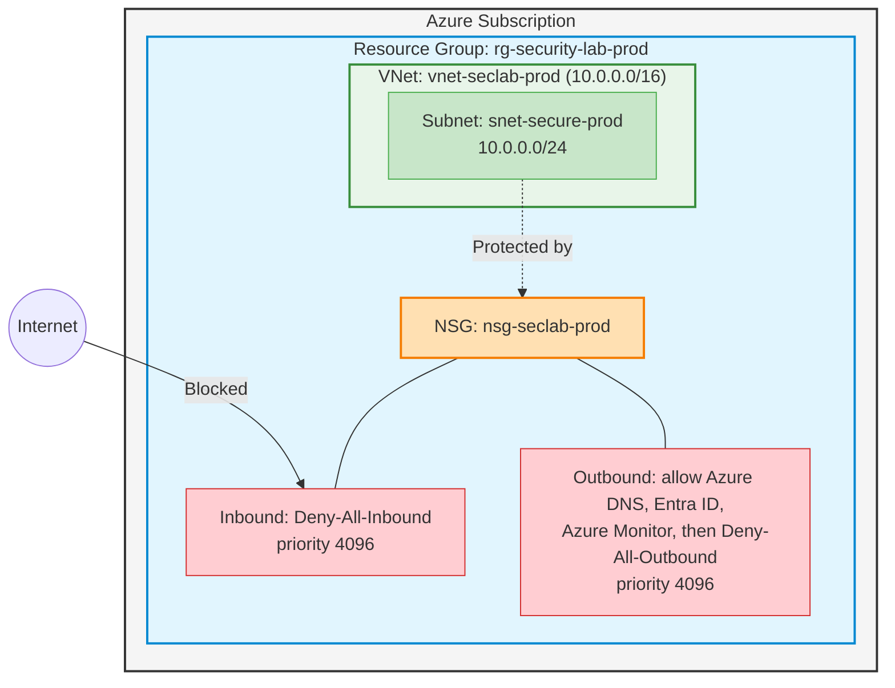
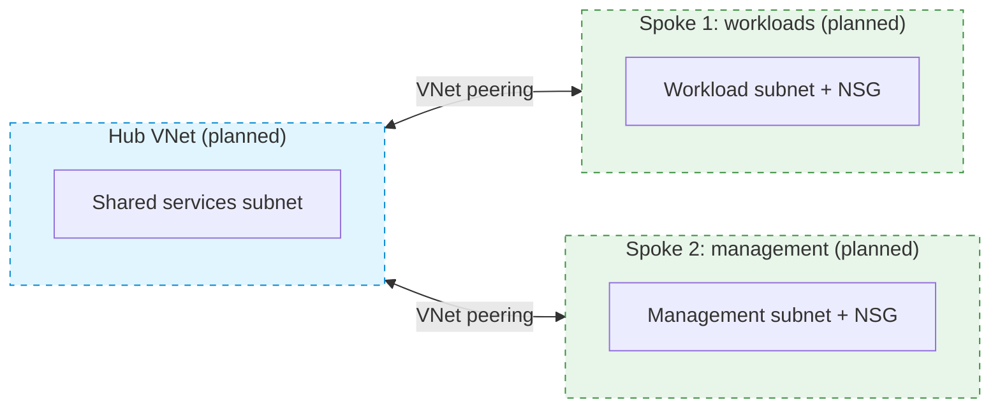

# Azure Cloud Security Labs

Hands-on cloud security labs built with **Azure Bicep (Infrastructure as Code)**. The repository focuses on repeatable, parameter-driven deployments and a zero-trust approach to network segmentation.

> **Status:** active lab. Sections marked *Planned* are on the roadmap and not yet implemented.

## Architecture

Current deployed state: a single VNet with one subnet bound to a deny-by-default NSG.



## What's implemented

### Network baseline (`main.bicep` + `network.bicep`)

`main.bicep` is a thin, resource-group-scope entry point that owns naming, tags and parameters, and calls a reusable `network.bicep` module built on [Azure Verified Modules](https://aka.ms/avm). Together they deploy:

| Component | Name | Notes |
|---|---|---|
| Resource group | `rg-security-lab-prod` | Created once outside the pipeline; the template deploys into it |
| Network security group | `nsg-seclab-prod` | Zero-trust rule baseline, attached to every subnet |
| Virtual network | `vnet-seclab-prod` | Address space `10.0.0.0/16` |
| Subnet | `snet-secure-prod` | `10.0.0.0/24`, bound to the NSG |

Names, address prefixes, subnets and rules are all parameters, so the same template scales to more subnets or environments without code changes.

### Zero-trust NSG design

Traffic is denied by default in **both directions**, and only explicitly defined flows are allowed.

| Priority band | Purpose |
|---|---|
| 100-499 | Platform and baseline allows (e.g. Azure DNS / VM agent) |
| 500-999 | Shared services (Microsoft Entra ID, Azure Monitor) using service tags |
| 1000-3999 | Workload-specific rules supplied through the `customRules` parameter |
| 4096 | Explicit `Deny-All-Inbound` and `Deny-All-Outbound` |

Design choices:

- Rules use arrays for address prefixes and port ranges, so a single rule can cover multiple ranges.
- Service tags are preferred over hard-coded IPs where possible.
- A `CanNotDelete` lock is applied to the NSG and VNet by default.

> **Scope note:** NSGs filter at layers 3 and 4. They do not evaluate identity or authentication, so they are one layer of a defense-in-depth design, not a complete zero-trust solution.

## Deployment

Prerequisites: Azure CLI with Bicep, and Contributor (or higher) on the target resource group.

```bash
# Preview changes
az deployment group what-if \
  --resource-group rg-security-lab-prod \
  --template-file main.bicep

# Deploy
az deployment group create \
  --resource-group rg-security-lab-prod \
  --template-file main.bicep
```

> Denying all outbound traffic will block anything not explicitly allowed (package repositories, extensions, updates). Validate with `what-if` and test on a non-production subnet first.

## Roadmap (Planned)

### Planned topology: hub-and-spoke



Peering and NSGs add little to no cost. Hourly-billed services such as Azure Firewall and Bastion are intentionally left out and can be added for short, time-boxed demos.


- [ ] Hub-and-spoke topology with VNet peering
- [ ] Azure Firewall or NVA for centralized egress control
- [ ] Application security groups for role-based micro-segmentation
- [ ] VNet flow logs and diagnostic settings into Log Analytics
- [ ] Microsoft Sentinel integration (see the honeypot lab)
- [ ] Private endpoints for PaaS services
- [ ] Hybrid identity: Active Directory to Microsoft Entra ID integration walkthrough
- [ ] Automated vulnerability tracking with Defender for Cloud

## Repository notes

- Don't commit secrets, subscription or tenant IDs, or real corporate IP ranges. Use documentation ranges such as `203.0.113.0/24` in examples, and pass sensitive values as `@secure()` parameters sourced from Key Vault.
